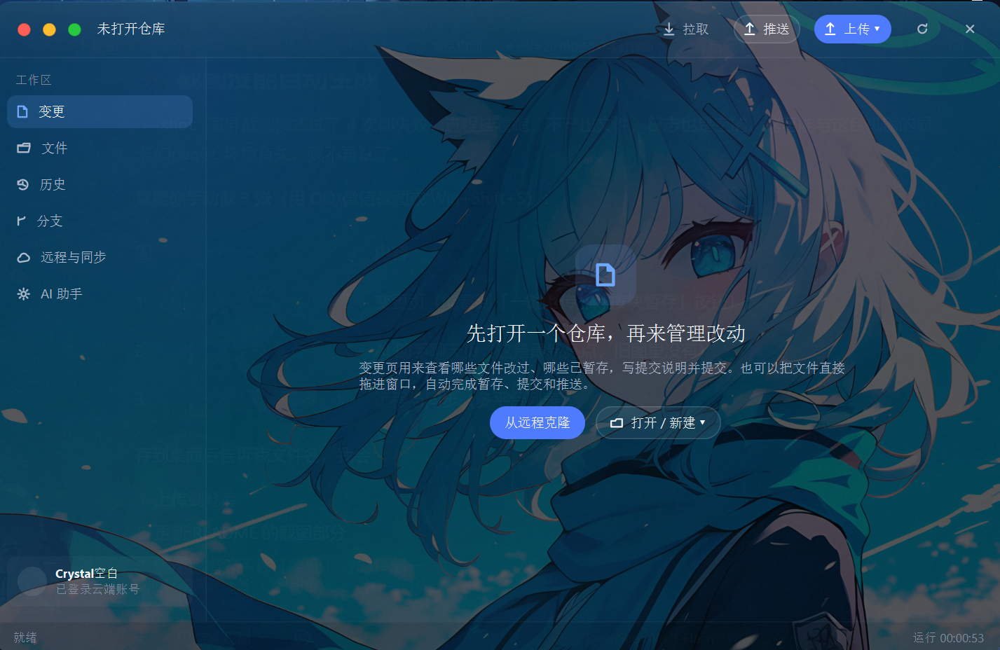
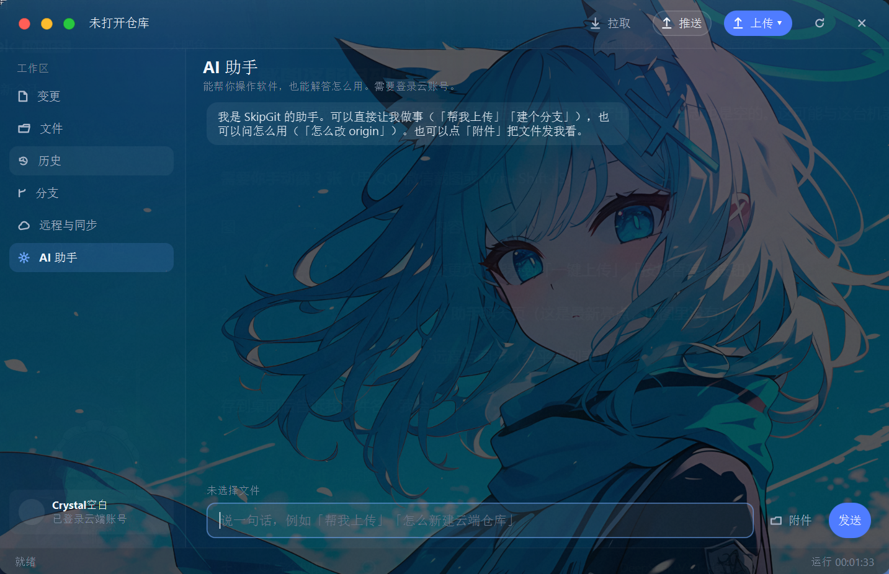
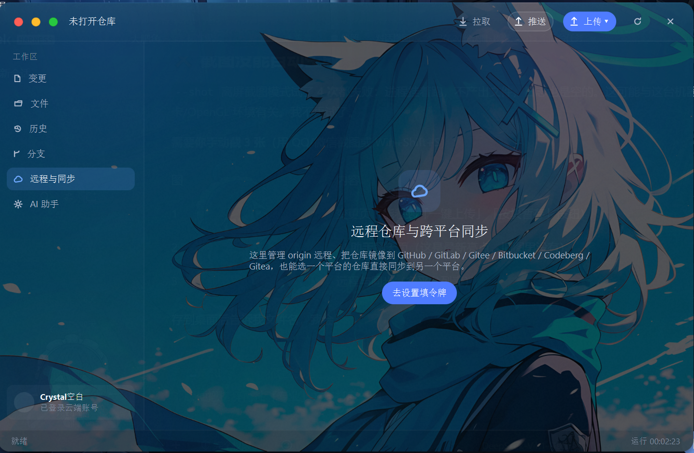

<div align="center">

# SkipGit

**纯 Java 构建的跨平台桌面 Git 客户端**

内置 Git 与 Git LFS 引擎，不依赖系统 `git` / `git-lfs`，下载即用。

[](https://openjdk.org/)
[](https://openjfx.io/)
[](https://www.eclipse.org/jgit/)
[](LICENSE)
[](#运行环境)

</div>

---

## 概览

SkipGit 是一个完全用 Java 实现的桌面 Git 客户端。它把 Git 引擎（JGit）和 LFS 客户端直接嵌进进程，因此**不需要在系统上安装 git 或 git-lfs**，也不依赖 WebView、Electron 或任何外部命令。

界面层用 JavaFX 自绘，采用无边框窗口、圆角投影与磨砂玻璃材质，交互带缓动动画。

目标是在「零配置可用」和「完整 Git 能力」之间取平衡：新手可以把文件拖进窗口直接完成提交与推送，熟悉 Git 的人也能找到按块暂存、强制重置、冲突逐个选择这类细粒度操作。

---

## 特性

### 仓库管理
- 打开本地仓库 / 本地初始化 / 从远端克隆
- 云端新建仓库，自动关联 `origin` 并完成首次推送
- 启动时恢复上次打开的仓库

### 变更与提交
- 未暂存与已暂存分列展示，支持文本 diff 预览
- 单文件暂存、全部暂存、丢弃未暂存改动
- **一键上传**：暂存 → 提交 → 推送合并为一个动作
- 提交说明留空时自动生成 `chore: 更新 MM-dd HH:mm`

### 历史与回退
- 提交列表带轻量分支拓扑（合并提交以不同色节点标识）
- 历史检索：按提交信息、作者、哈希过滤
- 三种回退语义：**撤销到此提交**（保留工作区）、**强制重置**（丢弃改动）、**回滚本次提交**（生成反向提交，可直接推送）

### 冲突处理
- 拉取或合并产生冲突时，变更页顶部展示冲突处理条
- 对每个冲突文件可分别选择：采用本地版本、采用远端版本、手动编辑、标记已解决

### 分支
- 查看本地与远端分支、新建并切换、切换、合并、删除

### 远端与多平台
- 推送、拉取、刷新
- 修改 `origin` 地址
- 将账号下的云端仓库一键设为 `origin`
- 跨平台镜像：GitHub ↔ GitLab ↔ Gitee ↔ Bitbucket ↔ Codeberg ↔ Gitea

### 云端文件直改
不克隆也能编辑远端文件：浏览目录 → 打开文件 → 编辑 → 保存，变更直接提交到云端。

支持 GitHub、Gitee、GitLab、Gitea、Codeberg、Bitbucket。

### Git LFS
- `.gitattributes` 规则管理
- 提交时自动将大文件替换为指针并上传对象，检出后自动还原实体

### AI 助手
左侧导航中的独立页面，以对话方式工作：

- **执行操作**：「帮我上传」「建一个 `feature/login` 分支」会直接执行
- **解答用法**：「怎么改 origin」返回分步说明
- **分析文件**：附带文件后读取内容，给出问题诊断与改进建议；超过 50 KB 自动分段汇总
- 每次请求附带当前软件状态（仓库、分支、未提交改动、`origin`），用于消解指代与歧义
- 仅发送用户输入与主动选中的文件内容，不上传令牌、密码或未选中的仓库文件

### 云端账号
- 邮箱验证码注册、登录、重置密码（Supabase 承载）
- 令牌与敏感配置以登录密码加密后同步到云端，换设备登录自动恢复
- 异地登录触发安全邮件验证

### 其他
- 中英文界面切换
- 版本检查与一键下载新版本
- 背景图、透明度、动态背景可调
- 所有可交互控件提供悬停说明
- Git 错误信息本地化：将原始报错翻译为原因 + 处理建议

---

## 界面

<div align="center">

**变更页** — 未暂存 / 已暂存分列、diff 预览、一键上传



**AI 助手** — 对话式执行与答疑



**远程与同步** — origin 管理与跨平台镜像



</div>

---

## 运行环境

| 项目 | 要求 |
| --- | --- |
| JDK | **21**（Microsoft Build of OpenJDK 或任意 21 发行版） |
| 图形 | JavaFX 21（随项目依赖提供，无需单独安装） |
| 系统 | Windows 10 / 11（其他平台未验证） |
| 外部依赖 | **无** —— 不需要 git、git-lfs |

## 构建

```bash
./build.sh
```

构建流程：

1. `javac` 编译全部源码
2. 打包 `target/skipgit.jar`
3. 收集运行时依赖到 `build/lib`
4. 生成 CDS 归档 `build/skipgit.jsa`（加快后续启动）

## 运行

```bash
./run.bat
```

等价命令：

```bash
java --module-path build/lib/fx --add-modules javafx.controls \
     -Djdk.tls.client.protocols=TLSv1.2 -Dprism.order=d3d,sw \
     -cp "target/skipgit.jar;build/lib/jgit.jar;build/lib/ewah.jar;build/lib/slf4j.jar;build/lib/codec.jar;build/lib/gson.jar" \
     com.skipgit.Launcher
```

### 启动参数

| 参数 | 说明 |
| --- | --- |
| `--repo <path>` | 启动时直接打开指定仓库 |
| `--page <name>` | 启动后切换到指定页面：`changes` / `files` / `history` / `branches` / `remote` / `assistant` |
| `--shot <file>` | 渲染一帧并保存为 PNG |

---

## 架构

```
┌──────────────────────────────────────────┐
│  界面层  JavaFX (ui/)                     │
│  GlassWindow · MainView · 各功能视图      │
├──────────────────────────────────────────┤
│  引擎层  (core/)                          │
│  GitService   → JGit 封装                │
│  LfsClient    → LFS Batch API            │
│  HostClient   → 六平台统一抽象            │
│  AiClient     → 指令解析与问答            │
│  Supabase*    → 账号、会话、配置同步      │
└──────────────────────────────────────────┘
```

**关键设计**

- **多平台统一抽象**：`HostClient` 定义建仓、改仓库信息、云端文件读写等能力，五个平台各自实现，界面层只面对接口
- **云端文件读写抽象**：`listCloud` / `readCloudFile` / `writeCloudFile` 三个方法覆盖六平台，通过 `origin` 地址自动路由
- **启动时序**：主界面先构建并显示，背景图与远端状态延后 120 ms 加载，避免图片解码阻塞首帧

## 技术栈

| 部分 | 选择 |
| --- | --- |
| 语言 / 运行时 | Java 21 |
| 界面 | JavaFX 21（controls + graphics） |
| Git 引擎 | JGit 6.10（纯 Java） |
| LFS | 自研 HTTP 客户端（Batch API） |
| JSON | Gson 2.11 |
| 云端账号 | Supabase（PostgREST + Auth） |
| 构建 | Shell 脚本 + `javac` / `jar` / CDS |

## 目录结构

```
src/main/java/com/skipgit/
├── App.java              启动入口、自动更新、启动时序
├── Launcher.java         无模块依赖引导
├── core/                 引擎层
│   ├── GitService        Git 操作（状态、提交、推送、撤销、按块暂存）
│   ├── LfsClient         LFS Batch API
│   ├── LfsManager        .gitattributes 规则与指针处理
│   ├── HostClient        六平台统一接口
│   ├── Supabase*         账号、会话、配置同步
│   ├── AiClient          AI 助手
│   ├── CommandAssistant  动作定义
│   ├── UpdateChecker     版本检查
│   └── Updater           新版本下载
└── ui/                   界面层
    ├── GlassWindow       无边框毛玻璃窗口
    ├── MainView          主框架与页面路由
    ├── ChangesView       变更页（冲突处理）
    ├── HistoryView       历史页（拓扑、检索、回退）
    ├── RemoteView        远端与跨平台同步
    ├── AssistantView     AI 助手
    ├── RemoteEditDialog  云端文件直改
    └── Widgets           自绘控件库
```

---

## 已知限制

- 仅在 Windows 10 / 11 上验证，其他平台未测试
- 尚不支持 SSH 密钥认证，仅支持 HTTPS + 访问令牌
- 同一平台当前只保留一个账号凭据
- **按块暂存（`git add -p`）尚未可用**：实测写入索引会导致 `.git/index` 损坏，入口已隐藏，待修复
- `--shot` 离屏截图在部分显卡环境下会挂起，无法产出文件
- 暂未提供独立安装包，需要自行构建或用 `run.bat` 启动

## 常见问题

**提示「认证失败」**
令牌无效或过期。到「设置 → 账号与令牌」重新填写，确认勾选了仓库读写权限。

**提示「推送被拒绝」**
远端存在本地没有的提交。先点「拉取」，处理差异后再推送。

**大文件推送失败**
在「远程与同步」添加 LFS 规则（如 `*.psd`），提交时自动转为指针文件。

**启动偏慢**
启动阶段会加载背景图并校验云端会话，各阶段耗时记录在 `~/.skipgit/startup.log`。

**更换设备后令牌丢失**
登录同一云账号即可恢复（需使用相同的登录密码解密）。

---

## 协议

[MIT](LICENSE) © 2026 CrystalKBITZ
